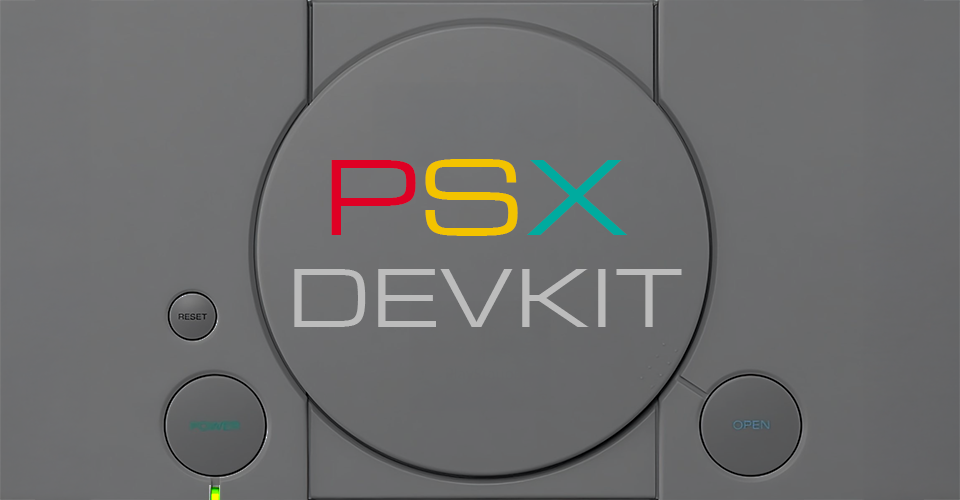
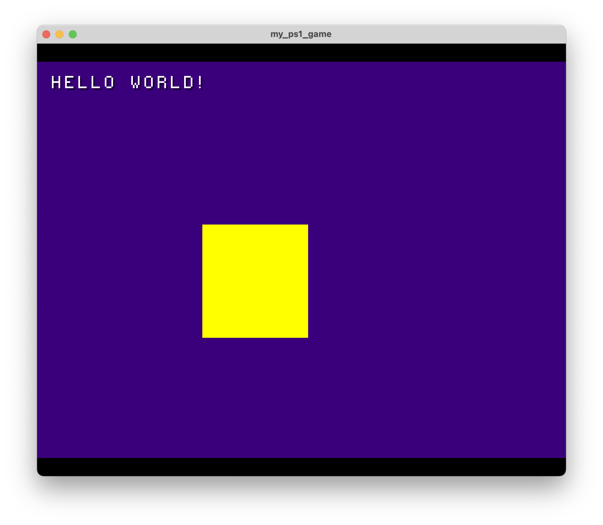
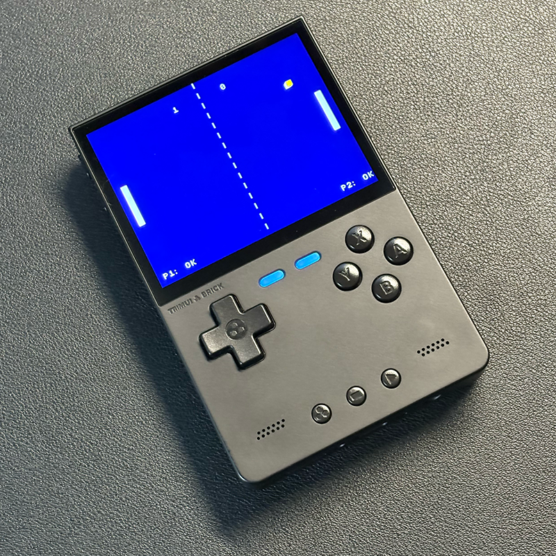

<p align="center">
  
</p>

# PS1 Development Environment

[](https://github.com/marconvcm/ps1_dev/actions/workflows/build.yml)
[](LICENSE)
[](https://github.com/Lameguy64/PSn00bSDK)

A modern, containerized development environment and project template for **PlayStation 1 (PS1/PSX)** homebrew game development. Built on **[PSn00bSDK](https://github.com/Lameguy64/PSn00bSDK)** with modern toolchains (GCC 12.3 MIPS bare-metal, CMake, Ninja) and zero host dependencies beyond Docker and Make.

Includes a fully playable 2-player Pong demo with analog stick support, AI fallback, fixed-point math, and an automated sprite asset pipeline.

<p align="center">
  
</p>

<p align="center">
  
</p>

---

## Features

- **Isolated Docker Environment:** Bundles the `mipsel-none-elf` GCC 12.3.0 cross-compiler, CMake, Ninja, and `mkpsxiso`.
- **Zero Host Toolchain Dependencies:** No Ruby, Python, or MIPS cross-compilers required on your host machine—only Docker and Make.
- **Permission-Safe Builds:** Containers run with host user permissions (`UID:GID`), preventing `root`-owned build lockouts.
- **Automated Asset Pipeline:** Automatically converts PNG images into PS1 TIM files and dynamically embeds them into the executable with an auto-generated `assets/assets.h` header.
- **1-Click Project Renaming:** Run `make rename NEW_NAME=my_game` to update project names across CMake, disc descriptors, and binary outputs simultaneously.
- **VS Code & Cursor Ready:** Includes `.devcontainer` and `.vscode` configs with full C/C++ IntelliSense for PS1 hardware headers.
- **CI/CD Ready:** Includes a GitHub Actions workflow that builds the CD image and publishes `.bin`/`.cue` release artifacts on push.
- **Cross-Platform Emulator Support:** Auto-detects [DuckStation](https://www.duckstation.org/) across macOS (App bundle), Linux (Native binary / Flatpak), and Windows (WSL).

---

## Dependencies

- **[Docker](https://docs.docker.com/get-docker/)** (or Docker Desktop)
- **Make**
- **PS1 Emulator** (e.g., [DuckStation](https://www.duckstation.org/))

---

## Quick Start

### 1. Create a New Game from this Template
```bash
git clone https://github.com/marconvcm/ps1_dev.git my_game
cd my_game && rm -rf .git && git init
```
*(See the [Template Setup Guide](#template-setup-guide) below for a detailed explanation).*

### 2. Rename the Project
```bash
make rename NEW_NAME=my_game
```
*(Project names must be `snake_case` starting with a letter).*

### 3. Build the Docker Image
```bash
make prepare
```
*(This only needs to be run once).*

### 4. Build the Game
```bash
make build
```
Builds the CD image in the `out/` directory:
- `out/<project_name>.bin`
- `out/<project_name>.cue`
- `out/<project_name>.exe`

### 5. Run in Emulator
You can either download DuckStation into the project automatically:
```bash
make get-duckstation
```
Or use a system-wide DuckStation installation. Then run:
```bash
make emulate
```
*(You can also pass a custom path via `DUCKSTATION=/path/to/duckstation make emulate`).*

### 6. Package for Distribution
```bash
make dist
```
Generates a release-ready zip file in `dist/<project_name>.zip` containing the `.bin` and `.cue` files.

---

## Template Setup Guide

When adapting this template for your own project, follow these steps to detach it from the original repository history, establish your own Git repository, and rename the project.

### 1. Detaching Git History & Initializing a New Repository

Cloning this repository includes the git commit history and remote tracking of `marconvcm/ps1_dev`. To create a clean standalone repository for your game:

```bash
# 1. Clone the template into your new project directory
git clone https://github.com/marconvcm/ps1_dev.git my_game
cd my_game

# 2. Delete the template's Git history and remote configuration
rm -rf .git

# 3. Initialize a clean Git repository
git init
git branch -M main

# 4. Create your initial commit
git add .
git commit -m "Initial commit from ps1_dev template"

# 5. Link to your own remote repository (GitHub, GitLab, etc.) and push
git remote add origin https://github.com/<your-username>/my_game.git
git push -u origin main
```

> [!NOTE]
> If you clicked GitHub's **"Use this template"** button instead of `git clone`, GitHub automatically initializes a clean repository history for you. In that case, simply clone your new repository locally and proceed to renaming.

---

### 2. Renaming the Project

The template provides an automated renaming command that updates the project name across all build configurations and metadata simultaneously:

```bash
make rename NEW_NAME=my_game
```

> [!IMPORTANT]
> The project name must be formatted in **`snake_case`** (lowercase letters, numbers, and underscores, beginning with a letter). For example: `my_game`, `space_invaders`, `kart_racer`.

#### How Project Renaming Works Under the Hood:

When you run `make rename NEW_NAME=<name>`, the following files and configurations are updated:

1. **`.project`:** Stores the active project name. The `Makefile` reads this file dynamically to determine target filenames for emulator launches (`make run`, `make emulate`), binary checks (`out/<name>.bin`), and zip distributions (`dist/<name>.zip`).
2. **`src/CMakeLists.txt`:** Updates `project(<name> ...)` and the corresponding executable and CD image targets (`psn00bsdk_add_executable`, `psn00bsdk_add_cd_image`).
3. **`src/iso.xml`:** Uses `${PROJECT_NAME}` dynamically from CMake. Renaming CMake automatically updates the disc volume label (`volume="${PROJECT_NAME}"`), volume set, and maps `${PROJECT_NAME}.exe` as `GAMEPS1.EXE` on the PS1 filesystem.
4. **Build Outputs:** Subsequent builds will generate:
   - `out/<name>.bin` and `out/<name>.cue` (standard PS1 CD-ROM image)
   - `out/<name>.exe` (MIPS executable)
   - `dist/<name>.zip` (release package created via `make dist`)

---

### 3. Transitioning from Demo to Your Own Game

The repository includes a 2-player Pong demo as a reference implementation. To start developing your own game:

- **Game Logic (`src/main.c`):** Replace the Pong game loop, rendering routines, and paddle physics with your custom gameplay code.
- **Assets (`src/assets/`):** Replace the demo PNG textures (`paddle.png`, `ball.png`, `font.png`) with your own graphics. The build system will automatically convert them to `.tim` format and update `src/assets/assets.h`.
- **Core Libraries (`src/libs/`):** You can keep and leverage the included reusable modules:
  - [`game_pad.h`](src/libs/game_pad.h): Controller input abstraction (digital buttons, D-Pad, dual analog sticks).
  - [`math.h`](src/libs/math.h): Hardware-friendly fixed-point trigonometry lookup tables (`sin`, `cos`).
  - [`numeric.h`](src/libs/numeric.h): Vector2 and Vector3 operations.

---

## Makefile Reference

| Target | Description |
| :--- | :--- |
| `make prepare` | Builds the Docker development image (`psn00bsdk`). |
| `make build` | Converts assets and compiles the game into `.bin` / `.cue` CD image. |
| `make compile` | Runs the CMake/Ninja build inside Docker without re-running asset conversion. |
| `make png2tim` | Converts PNG assets in `src/assets/` to PS1 TIM format with safe VRAM offsets. |
| `make get-duckstation` | Downloads DuckStation emulator (Linux AppImage, macOS bundle, or Windows) into `.duckstation/`. |
| `make emulate` | Builds the game and launches DuckStation with `-fastboot`. |
| `make run` | Builds the game and launches DuckStation with standard BIOS boot sequence. |
| `make up` | Rebuilds the Docker image, compiles, and launches the emulator in one step. |
| `make clean` | Removes the `out/` build artifacts and `dist/` release packages. |
| `make rename NEW_NAME=<name>` | Renames the project across `CMakeLists.txt`, `.project`, and disc descriptors. |
| `make dist` | Cleans, builds, and creates a distributable zip archive in `dist/`. |

---

## Project Structure

```
├── .devcontainer/            # VS Code / Cursor Remote Container config
├── .github/
│   └── workflows/build.yml   # GitHub Actions CI build & release workflow
├── .vscode/                  # C/C++ IntelliSense and build tasks
├── Dockerfile                # PSn00bSDK Linux container definition
├── Makefile                  # Build orchestration & emulator automation
├── other/                    # PS1 hardware and OS reference manuals (PDF)
├── src/
│   ├── CMakeLists.txt        # CMake build script with auto-asset discovery
│   ├── CMakePresets.json     # Debug and Release build presets
│   ├── iso.xml               # CD layout definition for mkpsxiso
│   ├── system.cnf            # PS1 boot descriptor
│   ├── main.c                # Main game loop and render logic
│   ├── assets/               # Textures, sprites, and auto-generated assets.h
│   └── libs/
│       ├── game_pad.c/.h     # Structured controller input (D-Pad, face, analog)
│       ├── math.c/.h         # PS1-safe fixed-point & lookup table math
│       └── numeric.c/.h      # 2D and 3D vector operations
└── tools/
    └── png2tim/              # PNG to TIM converter utility
```

---

## Asset Pipeline (Adding Images)

1. Place your PNG file in `src/assets/` (indexed 4-bit, 8-bit, or 16-bit color).
2. Run `make build`.
3. The build system will:
   - Convert `my_image.png` $\rightarrow$ `my_image.tim` via `png2tim`.
   - Embed the TIM data into the binary.
   - Automatically append `extern u_long tim_my_image[];` into `src/assets/assets.h`.
4. Include and use it directly in your C code:
   ```c
   #include "assets/assets.h"

   // Upload to VRAM
   TIM_IMAGE image;
   GetTimInfo(tim_my_image, &image);
   LoadImage(image.prect, image.paddr);
   if (image.mode & 0x8) {
       LoadImage(image.crect, image.caddr);
   }
   ```

> [!TIP]
> Texture coordinates in PS1 VRAM (`1024x512`) must not overlap with the front or back framebuffers (`0, 0` to `320, 480`). `tools/png2tim/png2tim.sh` assigns default coordinates to safe off-screen VRAM ($X \ge 320$).

---

## IDE Setup (VS Code & Cursor)

### Option A: Dev Containers (Recommended)
1. Install the **Dev Containers** extension in VS Code.
2. Open this folder and click **Reopen in Container** when prompted.
3. You get a full Linux MIPS development environment inside the container with pre-configured IntelliSense, build tasks, and tools.

### Option B: Local VS Code
Pre-configured tasks are available under **Terminal $\rightarrow$ Run Task...** (or `Ctrl+Shift+B` to build).

---

## Running on Real Hardware

The output `out/<project_name>.bin` and `out/<project_name>.cue` are standard CD-ROM images compatible with:
- **Optical Disc Emulators (ODEs):** XStation, PSIO, Fenrir, PicoStation.
- **CD-R:** Burn at low speed (e.g. 4x–8x) to a quality CD-R using ImgBurn or Brasero, and play on a modchipped console, Unirom, or FreePSXBoot memory card.

---

## Contributing

Contributions, suggestions, and pull requests are welcome! If you encounter issues or have ideas for improvements, feel free to open an issue or submit a PR.

---

## License

This template is licensed under the [MIT License](LICENSE). PSn00bSDK is licensed under the LGPL/GPL license—see [PSn00bSDK repository](https://github.com/Lameguy64/PSn00bSDK) for library details.